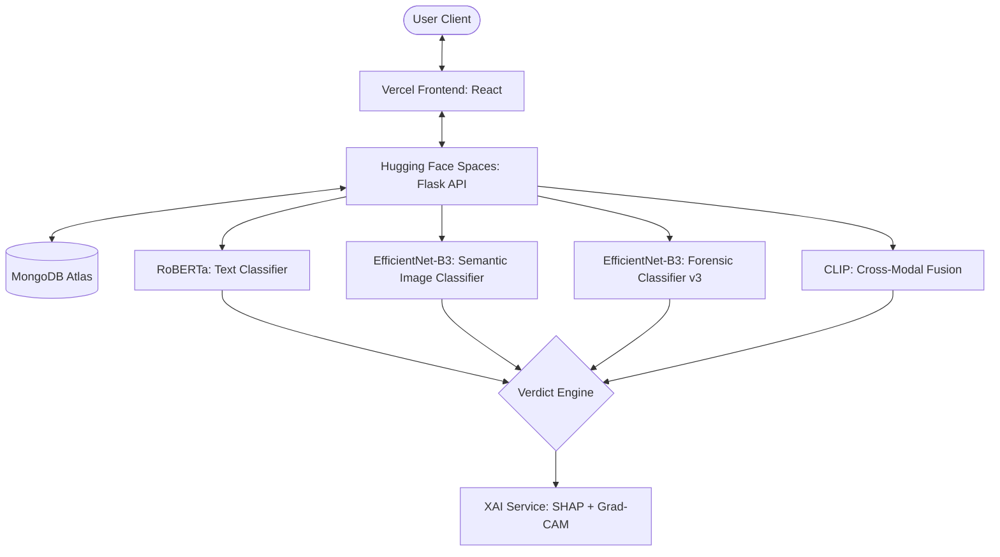

# 🛡️ FactFusion: Multimodal AI Misinformation & Disaster Information Detection

FactFusion is a multimodal misinformation detection system built for identifying fake news and unreliable disaster-related content across **text and images**. It combines four specialized deep learning models with Explainable AI (XAI) to not only classify content but show *why* a verdict was reached.

---

## 🌐 Live Deployments

- **Frontend App (Vercel):** [fact-fusion.vercel.app](https://fact-fusion.vercel.app)
- **Backend API (Hugging Face Spaces):** [inas-00-factfusion-backend.hf.space](https://inas-00-factfusion-backend.hf.space)
- **Model Weights:** [Inas-00/factfusion-weights](https://huggingface.co/datasets/Inas-00/factfusion-weights) (Hugging Face dataset repo)
- **Database:** MongoDB Atlas Cluster

---

## 🧠 Model Pipeline

FactFusion fuses four models to produce **8 possible verdict labels** combining text informativeness, image authenticity, and cross-modal consistency:

| Model | Task | Base Architecture |
| :--- | :--- | :--- |
| **Text Classifier** | Informative / Non-Informative / Out-of-Distribution (OOD) | RoBERTa |
| **Semantic Image Classifier** | Real Crisis / Normal Non-Crisis | EfficientNet-B3 |
| **Forensic Image Classifier** | Authentic / Tampered (image manipulation detection) | EfficientNet-B3 (`forensic_v3_model_BEST.pt`) |
| **Cross-Modal Fusion** | Text–image consistency / mismatch detection | CLIP |

The forensic model was retrained (v3) on synthetically tampered **disaster-domain** images after v2 was found to underperform on real-world disaster photos, having originally been trained only on the generic CASIA2 tampering dataset.

Verdict logic (in `multimodal_service.py`) accounts for edge cases such as non-informative or OOD text paired with mismatched images, and gracefully degrades when the forensic model is unavailable (flagged as `forensic_unavailable` rather than silently failing).

---

## 🛠️ Tech Stack

### Frontend
- **Framework:** React + Vite
- **Styling:** Vanilla CSS + TailwindCSS (dark theme, custom scrollbar styling)
- **Charts:** Chart.js / Recharts (XAI visualizations)

### Backend
- **Framework:** Python + Flask (Dockerized)
- **Machine Learning:** PyTorch, Transformers (Hugging Face), RoBERTa, EfficientNet-B3, CLIP
- **Explainability (XAI):**
  - **SHAP** — token-level text attributions (top 15 tokens)
  - **Grad-CAM** — visual heatmaps for image classifiers, with CLIP-based fallback
- **Deployment Platform:** Hugging Face Spaces (Docker SDK)
- **Model Distribution:** Hugging Face Hub (`hf_hub_download`) from a dedicated weights dataset repo

### Database & Authentication
- **Database:** MongoDB Atlas (Cloud Database)
- **Auth:** Token-based sessions; admin-controlled password reset (no self-service SMTP flow)

---

## 🏗️ Architecture



---

## 📂 Project Structure & Key Files

### Backend Directory (`/backend`)
* **Core Services:**
  * `server.py`: Entry point for the Flask REST API.
  * `model_service.py`: Standard classification model logic.
  * `multimodal_service.py`: Multimodal fusion and verdict logic (text + image + forensic + CLIP).
  * `xai_service.py`: SHAP token attribution and Grad-CAM heatmap generation.
  * `database.py`: MongoDB Atlas connection handlers.
* **Setup & Helper Scripts:**
  * `download_models.py`: Fetches model weights from the Hugging Face weights repo at startup.

### Frontend Directory (`/src`)
* `verdict.js`: Shared utility for interpreting and displaying the 8 verdict labels consistently across the UI.
* `AnalysisHistory.jsx`: Paginated, real-time-polling history view.
* `XAIInsights.jsx`: Renders SHAP bar charts and Grad-CAM heatmaps.
* `Login.jsx`: Auth flow with email domain typo suggestions.

---

## ✨ Features

- **Multimodal AI Analysis:** Simultaneously analyze text and image uploads for misinformation and manipulation.
- **Disaster-Aware Classification:** Purpose-built for distinguishing real crisis content from unrelated or fabricated imagery.
- **Forensic Image Analysis:** Detects tampered/manipulated images using a domain-adapted forensic classifier.
- **Cross-Modal Consistency Checks:** Flags mismatches between text claims and accompanying images via CLIP.
- **Explainable AI (XAI) Insights:** SHAP token attributions and Grad-CAM heatmaps for full transparency into every verdict.
- **User Authentication:** Secure signup/login with admin-controlled password recovery.
- **Analysis History:** Paginated, real-time-updating dashboard of past queries.

---

## 🚀 Local Development Setup

### Prerequisites
- Python 3.9+
- Node.js 18+
- MongoDB Atlas Account (or Local MongoDB)

### 1. Database Setup
1. Create a free database cluster on [MongoDB Atlas](https://cloud.mongodb.com).
2. Allow connection access from your current IP.
3. Retrieve your connection string.

### 2. Backend Setup
```bash
# Navigate to the backend directory
cd backend

# Create and activate virtual environment
python -m venv .venv
source .venv/bin/activate  # On Windows: .venv\Scripts\activate

# Install dependencies
pip install -r requirements.txt

# Create .env file with your variables
# MONGO_URI=mongodb+srv://...
# SECRET_KEY=your_secret_key
# FLASK_ENV=development

# Start backend server
python server.py
```

> **Note:** On first run, `download_models.py` will pull model weights from the Hugging Face weights repo. Ensure `numpy==1.26.4` is installed (required for SHAP compatibility — NumPy 2.x will break XAI features).

### 3. Frontend Setup
```bash
# From the root directory
# Install node packages
npm install

# Start Vite development server
npm run dev
```

---

## ⚙️ Environment Variables

### Backend (`backend/.env`)
| Variable | Description |
| :--- | :--- |
| `MONGO_URI` | MongoDB Atlas cluster connection string |
| `SECRET_KEY` | Secure key for token creation / session encryption |
| `FLASK_ENV` | `development` or `production` |

### Frontend (`.env.production`)
| Variable | Description |
| :--- | :--- |
| `VITE_API_URL` | Base URL of your backend on Hugging Face Spaces |

---

## 📦 Deployment Notes

- Backend is deployed as a Docker Space on Hugging Face (migrated from Railway due to RAM limits — the full model stack exceeds Railway's ~512MB cap on free tiers).
- Model weights are hosted separately in a Hugging Face dataset repo and downloaded at container startup via `hf_hub_download`, avoiding large files in the Docker image itself.
- The Hugging Face Space is auto-synced from this GitHub repository using an `HF_TOKEN` secret — pushing to `main` automatically triggers an update and redeploy of the backend Space. No manual `hf upload` or second git remote needed.
  ```bash
  git add .
  git commit -m "your message"
  git push origin main
  ```
- Frontend (Vercel) auto-deploys on push as well, via Vercel's GitHub integration.