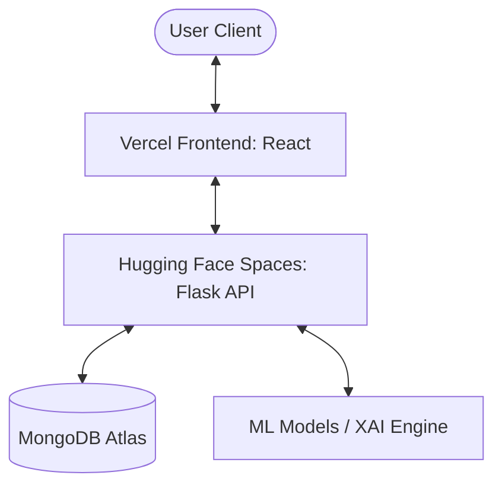

# 🛡️ FactFusion: Multimodal AI Misinformation Detection

FactFusion is a premium, state-of-the-art web application designed for multimodal misinformation detection. Utilizing advanced Explainable AI (XAI) insights and real-time crisis classification, FactFusion helps users analyze and verify the authenticity of text and image content.

---

## 🌐 Live Deployments

- **Frontend App (Vercel):** [fact-fusion.vercel.app](https://fact-fusion.vercel.app)
- **Backend API (Hugging Face Spaces):** [inas-00-factfusion-backend.hf.space](https://inas-00-factfusion-backend.hf.space)
- **Database:** MongoDB Atlas Cluster

---

## 🛠️ Tech Stack

### Frontend
- **Framework:** React + Vite
- **Styling:** Vanilla CSS + TailwindCSS (for responsive UI components)
- **Charts:** Chart.js / Recharts (for XAI visualization)

### Backend
- **Framework:** Python + Flask
- **Machine Learning / NLP:** Transformers (Hugging Face), PyTorch, Multimodal models
- **Explainability (XAI):** Integrated feature attribution and attention visualization services
- **Deployment Platform:** Hugging Face Spaces (Docker SDK)

### Database & Authentication
- **Database:** MongoDB Atlas (Cloud Database)
- **Auth:** Token-based session / user authorization


---

## 🏗️ Architecture



---

## 📂 Project Structure & Key Files

### Backend Directory (`/backend`)
* **Core Services:**
  * `server.py`: The entry point for the Flask REST API.
  * `model_service.py`: Standard classification model logic.
  * `multimodal_service.py`: Multimodal fusion logic for text + image.
  * `xai_service.py`: Explainable AI algorithms and token attribution analysis.
  * `database.py`: Configuration and handlers for MongoDB Atlas connections.
* **Setup & Helper Scripts:**
  * `download_models.py`: Utility script to fetch and download model weights.

---

## ✨ Features

- **Multimodal AI Analysis:** Simultaneously analyze and detect anomalies in text and image uploads.
- **Misinformation Detection:** State-of-the-art classifier providing confidence scores for text veracity.
- **Explainable AI (XAI) Insights:** Clear, interpretable visualization of model feature attributions.
- **User Authentication:** Secure signup/login flow to persist history.
- **Analysis History:** Dynamic user dashboard tracking previous classification queries.
- **Real-Time Classification:** Optimized inference pipeline for real-time responsiveness.

---

## 🚀 Local Development Setup

### Prerequisites
- Python 3.9+
- Node.js 18+
- MongoDB Atlas Account (or Local MongoDB)

### 1. Database Setup
1. Create a free database cluster on [MongoDB Atlas](https://cloud.mongodb.com).
2. Allow connection access from your current IP.
3. Retrieve your connection string.

### 2. Backend Setup
```bash
# Navigate to the backend directory
cd backend

# Create and activate virtual environment
python -m venv .venv
source .venv/bin/activate  # On Windows: .venv\Scripts\activate

# Install dependencies
pip install -r requirements.txt

# Create .env file with your variables
# MONGO_URI=mongodb+srv://...
# SECRET_KEY=your_secret_key
# FLASK_ENV=development

# Start backend server
python server.py
```

### 3. Frontend Setup
```bash
# From the root directory
# Install node packages
npm install

# Start Vite development server
npm run dev
```

---

## ⚙️ Environment Variables

### Backend (`backend/.env`)
| Variable | Description |
| :--- | :--- |
| `MONGO_URI` | MongoDB Atlas cluster connection string |
| `SECRET_KEY` | Secure key for token creation / session encryption |
| `FLASK_ENV` | `development` or `production` |

### Frontend (`.env.production`)
| Variable | Description |
| :--- | :--- |
| `VITE_API_URL` | Base URL of your backend on Hugging Face Spaces |

